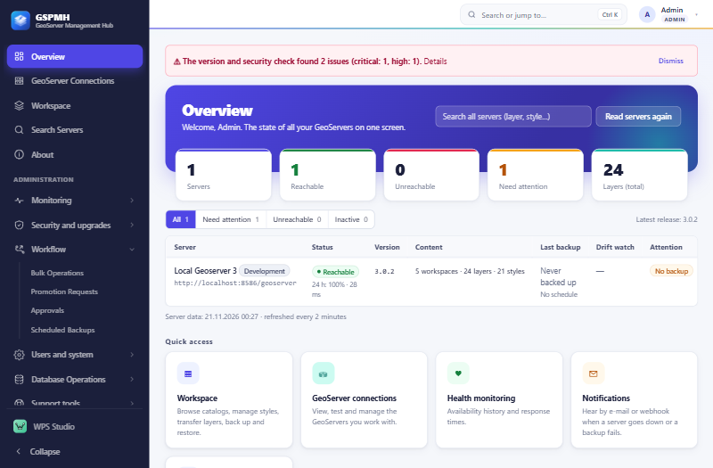
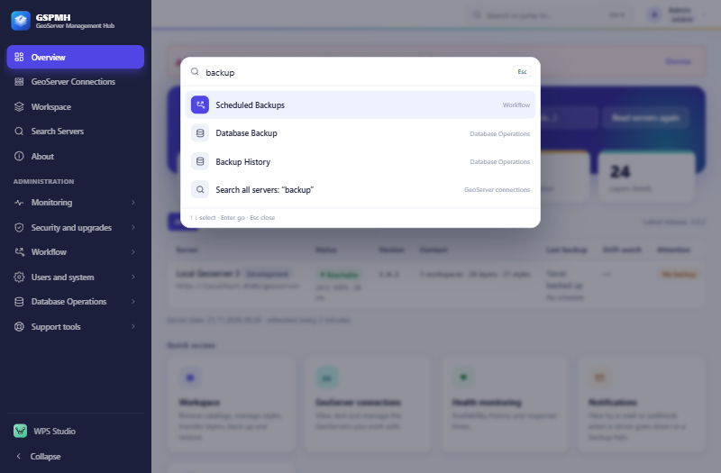
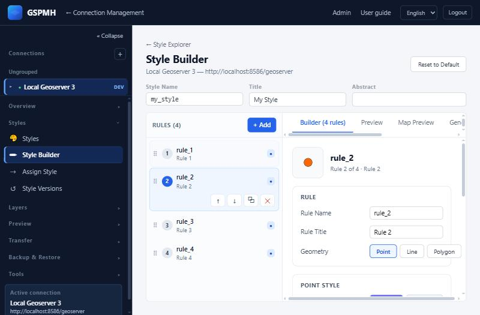
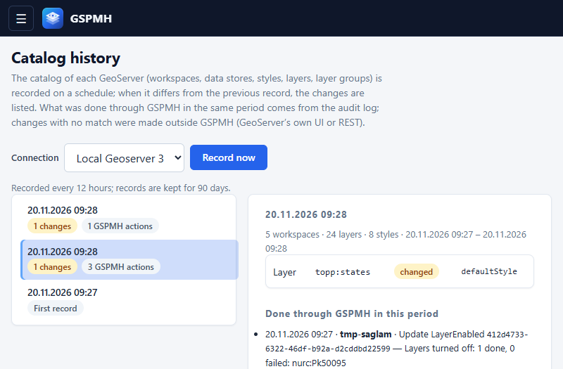
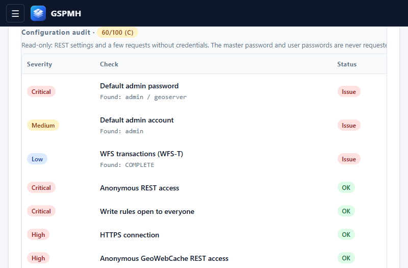
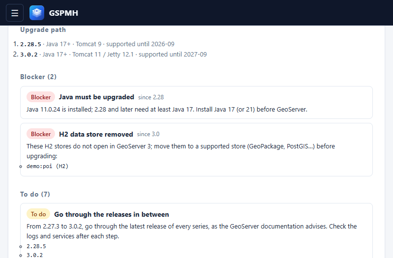
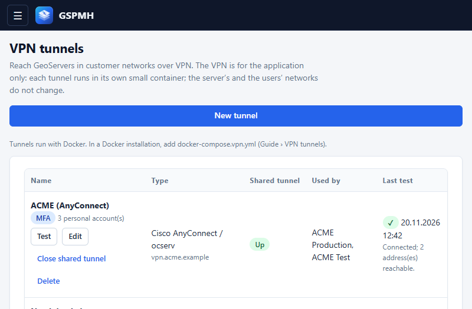
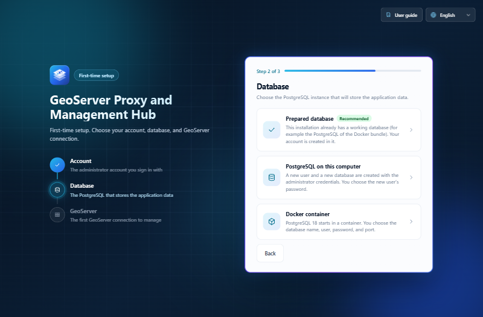

# GeoServer Proxy & Management Hub (GSPMH)

**One web application to manage many GeoServers**: development, test and production side by side, with transfers,
styles, backups, monitoring, security checks and upgrades in one place.

[Türkçe](README.tr.md) · [Try the showcase](#try-the-showcase) · [Install](#install) · [Update](#update) · [VPN tunnels](#vpn-tunnels-optional)



## Features

- **All servers on one screen**: reachability, version, layer count, last backup and what needs attention
- **Transfer** layers, styles, workspaces and data stores between GeoServers, one at a time or in bulk, with a plan preview and full undo when cancelled
- **Styles**: visual SLD builder, style version history and restore
- **Map preview**: layers from several GeoServers on one map; side-by-side layer preview
- **Backup and restore**: on demand or on a schedule, with backup verification
- **Catalog history**: what changed on a GeoServer, when, and whether it was done through GSPMH or outside it
- **Version and security check**: known vulnerabilities, end-of-support versions, TLS certificates and a configuration audit with a score
- **Upgrade planner**: Java requirements, removed features and a step-by-step upgrade path
- **VPN tunnels** for the application only: Cisco AnyConnect, Fortinet, Palo Alto GlobalProtect, Pulse/Ivanti, Check Point, OpenVPN, WireGuard, SSH
- **Operations**: health monitoring, drift watches, log alerts, e-mail/webhook notifications, weekly summary
- **Access control**: roles, per-workspace grants, two-factor sign-in, LDAP / Active Directory, single sign-on (OIDC), four-eyes approval, full audit log
- **Everyday use**: Ctrl+K to jump anywhere, searchable tables, 6 themes, Turkish and English, in-app user guide

GSPMH works on the GeoServer catalog through its REST API. It does not copy raw spatial data or database tables.

| | |
|---|---|
|  |  |
|  |  |
|  |  |

## Try the showcase

A public showcase runs at **[https://gspmh.wpsstudio.com](https://gspmh.wpsstudio.com)**. Sign in with a Google account, add your own GeoServer or use the
sample server. Visitors sign in as operators and see part of the menus; features meant for organisations
(administration, VPN, LDAP, scheduled jobs, monitoring…) are closed there. Data added in the showcase is deleted
every night at 00:00 UTC: do not enter real production passwords.

## Install

**Requirements:** a Linux server or a Windows PC with Docker (Docker Engine with Compose v2, or Docker Desktop),
2 CPU cores and 4 GB RAM, port 80 free. The GeoServers you manage must be reachable from this server.

### Linux

```bash
git clone https://github.com/mehmetalidumlu/GeoserverProxyManagementHub.git gspmh
cd gspmh
./install.sh
```

### Windows (Docker Desktop)

```powershell
git clone https://github.com/mehmetalidumlu/GeoserverProxyManagementHub.git gspmh
cd gspmh
powershell -ExecutionPolicy Bypass -File .\install.ps1
```

No git? Download the repository as a ZIP (Code › Download ZIP) and run the same script in the extracted folder.

The script writes `.env` with random passwords and keys, pulls the images and starts the containers: PostgreSQL,
the API and the web front end (plus the tunnel image with VPN). **Keep a copy of `.env`**: `ENCRYPTION_KEY` protects
the stored GeoServer passwords and must never change.

### First start

Open `http://<server>` (or `http://localhost` on Windows). The setup wizard asks for:

1. **Account**: the first administrator.
2. **Database**: choose **Prepared database** (the bundled PostgreSQL).
3. **GeoServer**: the address, user name and password of a running GeoServer (`http://host.docker.internal:8080/geoserver` for one on the same computer).



The in-app **User guide** (account menu) explains every page.

### Manual setup

```bash
cp .env.example .env      # replace every CHANGE_ME
docker compose up -d
```

## Update

```bash
./install.sh              # or .\install.ps1 on Windows
```

This pulls the newest images and restarts the containers; data stays in the Docker volumes (`gspmh-postgres-data`,
`gspmh-backup-data`, `gspmh-setup-data`). To stay on a release, set `GSPMH_VERSION=1.0.0` in `.env`.

## VPN tunnels (optional)

To reach GeoServers in customer networks over VPN, start with the VPN override:

```bash
./install.sh --vpn        # or .\install.ps1 -Vpn
```

The API then starts one small tunnel container per VPN connection through the Docker socket. The VPN runs only inside
that container; the server's own network does not change. Access to the Docker socket is access to the Docker host:
use it only where that is acceptable.

## Images

| Image | Purpose |
|---|---|
| `ghcr.io/mehmetalidumlu/geoserver-proxy-api` | API |
| `ghcr.io/mehmetalidumlu/geoserver-proxy-web` | Web front end (nginx, non-root, port 8080) |
| `ghcr.io/mehmetalidumlu/geoserver-proxy-api-vpn` | API with the Docker CLI, for VPN tunnels |
| `ghcr.io/mehmetalidumlu/geoserver-proxy-vpn-tunnel` | Tunnel image started by the API |

Each release is tagged with its version and `latest` (current release: **1.0.0**, linux/amd64). The packages are
listed under **Packages** on this repository and can be pulled without signing in:

```bash
docker pull ghcr.io/mehmetalidumlu/geoserver-proxy-api:1.0.0
```

## Feedback

Use **Feedback** in the account menu of the application, or open an issue in this repository.

## Third-party software

The images contain open-source components (.NET, nginx, Alpine Linux packages and others). The VPN tunnel image
includes [snx-rs](https://github.com/ancwrd1/snx-rs) (AGPL-3.0) unmodified, built from its published source; the
other VPN clients come from Alpine Linux packages.

## License

© 2026 Mehmet Ali DUMLU. All rights reserved. The images may be downloaded and run; the source code of GSPMH is not
published in this repository.
