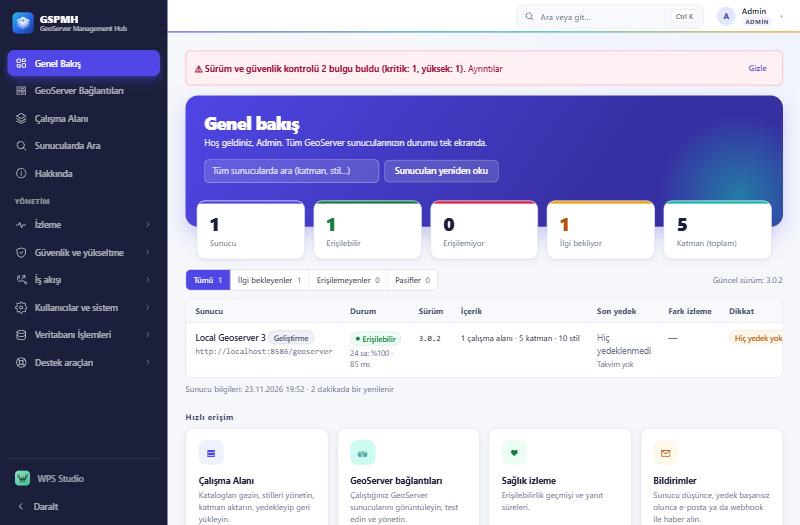
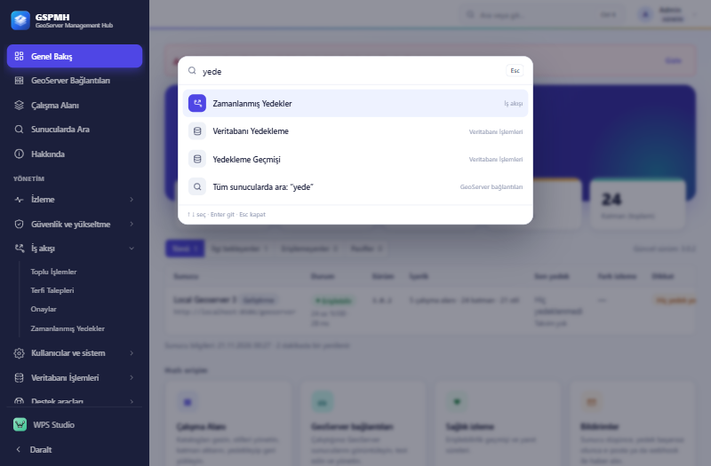
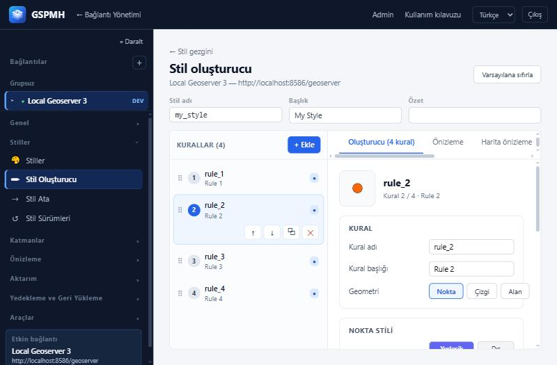
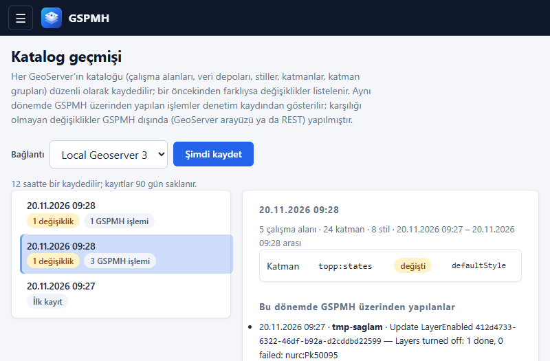
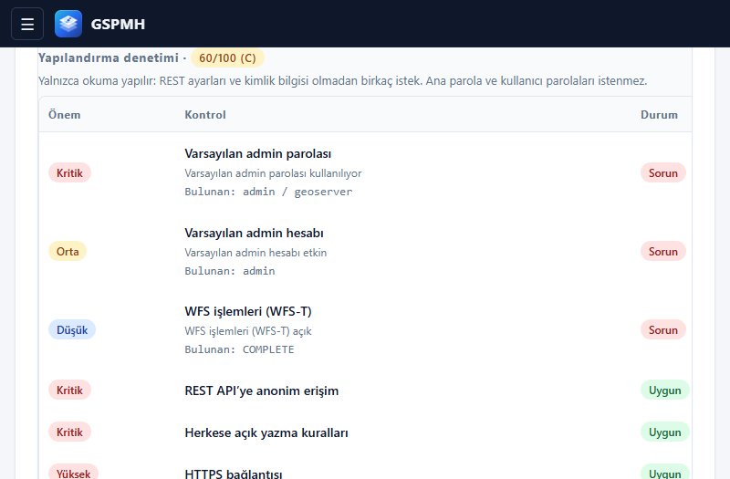
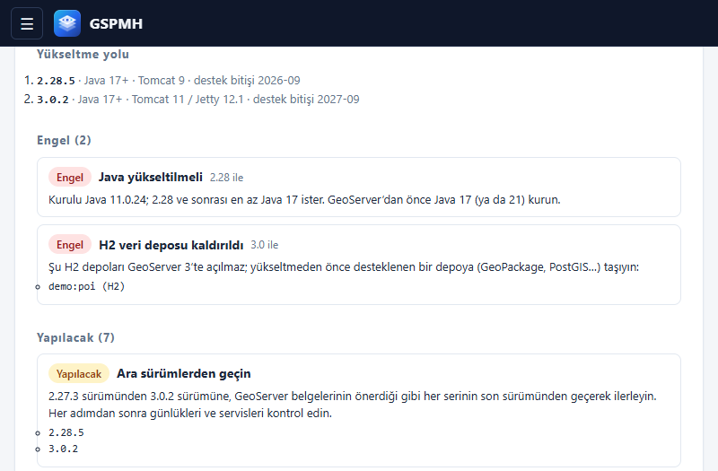
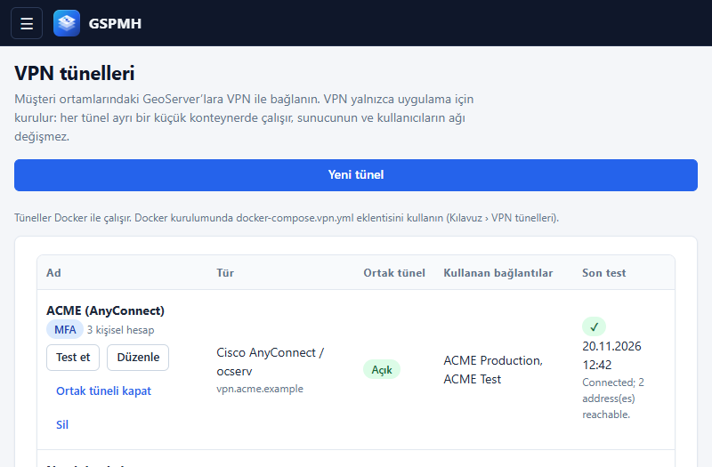
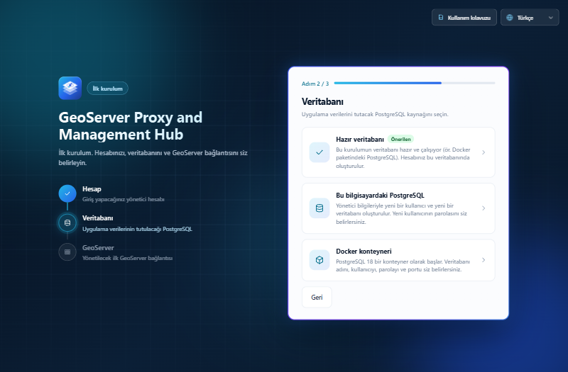

# GeoServer Proxy & Management Hub (GSPMH)

**Birden fazla GeoServer'ı tek bir web uygulamasından yönetin**: geliştirme, test ve canlı ortamlar yan yana;
aktarım, stil, yedekleme, izleme, güvenlik kontrolü ve yükseltme tek yerde.

[English](README.md) · [Tanıtım sürümü](#tanıtım-sürümü) · [Kurulum](#kurulum) · [Güncelleme](#güncelleme) · [VPN tünelleri](#vpn-tünelleri-isteğe-bağlı)



## Özellikler

- **Tüm sunucular tek ekranda**: erişilebilirlik, sürüm, katman sayısı, son yedek ve ilgi bekleyen durumlar
- **Aktarım**: katman, stil, çalışma alanı ve veri deposu; tekli ya da toplu, plan önizlemesiyle, iptal edilince tam geri alma
- **Stiller**: görsel SLD oluşturucu, stil sürüm geçmişi ve geri yükleme
- **Harita önizleme**: birden fazla GeoServer'ın katmanları tek haritada; iki katmanı yan yana karşılaştırma
- **Yedekleme ve geri yükleme**: isteğe bağlı ya da zamanlanmış, yedek doğrulamayla
- **Katalog geçmişi**: GeoServer'da neyin, ne zaman değiştiği ve bunun GSPMH'den mi dışarıdan mı yapıldığı
- **Sürüm ve güvenlik kontrolü**: bilinen açıklar, destek süresi biten sürümler, TLS sertifikaları ve puanlı yapılandırma denetimi
- **Yükseltme planlayıcı**: Java gereksinimi, kaldırılan özellikler ve adım adım yükseltme yolu
- **Yalnızca uygulamaya özel VPN tünelleri**: Cisco AnyConnect, Fortinet, Palo Alto GlobalProtect, Pulse/Ivanti, Check Point, OpenVPN, WireGuard, SSH
- **İşletim**: sağlık izleme, fark izleme, günlük uyarıları, e-posta/webhook bildirimleri, haftalık özet
- **Erişim denetimi**: roller, çalışma alanı bazında yetki, iki aşamalı doğrulama, LDAP / Active Directory, tek oturum açma (OIDC), dört göz onayı, tam denetim kaydı
- **Günlük kullanım**: Ctrl+K ile her yere hızlı erişim, aranabilir tablolar, 6 tema, Türkçe ve İngilizce arayüz, uygulama içi kullanım kılavuzu

GSPMH, GeoServer kataloğu üzerinde REST API ile çalışır. Ham mekânsal veriyi ya da veritabanı tablolarını kopyalamaz.

| | |
|---|---|
|  |  |
|  |  |
|  |  |

## Tanıtım sürümü

Herkese açık tanıtım sürümü: **[https://gspmh.wpsstudio.com](https://gspmh.wpsstudio.com)**. Google hesabınızla girin, kendi GeoServer'ınızı ekleyin
ya da örnek sunucuyla deneyin. Ziyaretçiler operatör olarak girer ve menülerin bir kısmını görür; kurumlara yönelik
özellikler (yönetim, VPN, LDAP, zamanlanmış işler, izleme…) bu sürümde kapalıdır. Eklenen veriler her gece
00:00 UTC'de silinir: gerçek üretim şifrelerinizi girmeyin.

## Kurulum

**Gerekenler:** Docker kurulu bir Linux sunucu ya da Windows bilgisayar (Compose v2 ile Docker Engine veya Docker
Desktop), 2 çekirdek ve 4 GB RAM, boş 80 portu. Yönetilecek GeoServer'lara bu sunucudan erişilebilmeli.

### Linux

```bash
git clone https://github.com/mehmetalidumlu/GeoserverProxyManagementHub.git gspmh
cd gspmh
./install.sh
```

### Windows (Docker Desktop)

```powershell
git clone https://github.com/mehmetalidumlu/GeoserverProxyManagementHub.git gspmh
cd gspmh
powershell -ExecutionPolicy Bypass -File .\install.ps1
```

Git yoksa depoyu ZIP olarak indirin (Code › Download ZIP), açtığınız klasörde aynı betiği çalıştırın.

Betik `.env` dosyasını rastgele şifre ve anahtarlarla oluşturur, imajları indirir ve konteynerleri başlatır:
PostgreSQL, API, web arayüzü ve (VPN ile) tünel imajı. **`.env` dosyasının bir kopyasını saklayın**: `ENCRYPTION_KEY`
kayıtlı GeoServer şifrelerini korur ve asla değiştirilmemelidir.

### İlk açılış

`http://<sunucu>` (Windows'ta `http://localhost`) adresini açın. Kurulum sihirbazı şunları sorar:

1. **Hesap**: ilk yönetici hesabı.
2. **Veritabanı**: **Hazır veritabanı**nı seçin (paketteki PostgreSQL).
3. **GeoServer**: çalışan bir GeoServer'ın adresi, kullanıcı adı ve şifresi (aynı bilgisayardaki için `http://host.docker.internal:8080/geoserver`).



Uygulama içindeki **Kullanım kılavuzu** (hesap menüsü) her sayfayı anlatır.

### Elle kurulum

```bash
cp .env.example .env      # her CHANGE_ME değerini değiştirin
docker compose up -d
```

## Güncelleme

```bash
./install.sh              # Windows'ta .\install.ps1
```

En yeni imajları indirir ve konteynerleri yeniden başlatır; veriler Docker birimlerinde kalır (`gspmh-postgres-data`,
`gspmh-backup-data`, `gspmh-setup-data`). Belirli bir sürümde kalmak için `.env` içinde `GSPMH_VERSION=1.0.0` yazın.

## VPN tünelleri (isteğe bağlı)

Müşteri ağlarındaki GeoServer'lara VPN ile ulaşmak için VPN eklentisiyle başlatın:

```bash
./install.sh --vpn        # Windows'ta .\install.ps1 -Vpn
```

API, her VPN bağlantısı için Docker soketi üzerinden küçük bir tünel konteyneri başlatır. VPN yalnızca o konteynerin
içinde çalışır; sunucunun kendi ağı değişmez. Docker soketine erişim Docker sunucusuna erişim demektir: yalnızca bunun
kabul edilebildiği yerlerde kullanın.

## İmajlar

| İmaj | Görevi |
|---|---|
| `ghcr.io/mehmetalidumlu/geoserver-proxy-api` | API |
| `ghcr.io/mehmetalidumlu/geoserver-proxy-web` | Web arayüzü (nginx, root olmayan kullanıcı, port 8080) |
| `ghcr.io/mehmetalidumlu/geoserver-proxy-api-vpn` | VPN tünelleri için Docker CLI'lı API |
| `ghcr.io/mehmetalidumlu/geoserver-proxy-vpn-tunnel` | API'nin başlattığı tünel imajı |

Her sürüm kendi numarasıyla ve `latest` olarak etiketlenir (güncel sürüm: **1.0.0**, linux/amd64). Paketler bu
deponun **Packages** bölümünde listelenir ve giriş yapmadan indirilebilir:

```bash
docker pull ghcr.io/mehmetalidumlu/geoserver-proxy-api:1.0.0
```

## Geri bildirim

Uygulamadaki hesap menüsünden **Geri bildirim**'i kullanın ya da bu depoda bir issue açın.

## Üçüncü taraf yazılımlar

İmajlar açık kaynak bileşenler içerir (.NET, nginx, Alpine Linux paketleri ve diğerleri). VPN tünel imajı
[snx-rs](https://github.com/ancwrd1/snx-rs) (AGPL-3.0) yazılımını değiştirilmeden, yayımlanmış kaynağından derlenmiş
olarak içerir; diğer VPN istemcileri Alpine Linux paketlerinden gelir.

## Lisans

© 2026 Mehmet Ali DUMLU. Tüm hakları saklıdır. İmajlar indirilip çalıştırılabilir; GSPMH'nin kaynak kodu bu depoda
yayınlanmaz.
